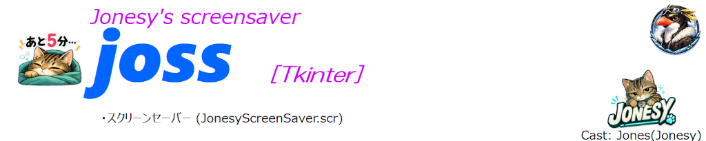
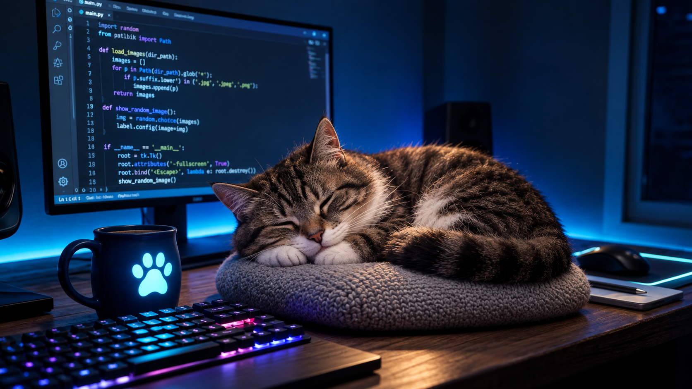
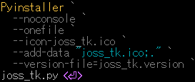

<p align="left">
  
  
</p>

<!-- PDF作成用
  
-->

# Jonesy Screen Saver [joss_tk]
<p align="left">
    
</p>

## Overview
　猫(Jonesy)がテーマのスクリーンセーバー。  
　Windows標準のコントロールパネルから起動できます。

## Purpose
* モニター表示固着回避

## Features
* 複数モニターへのランダム表示  
* 画像が複数モニター間を跨いでしまう現象の防止  
* 画像追加/削除  
  固有DIR {  ./scr_images\)へ表示したい画像をコピーする事で表示する画像を変更できます。

## Usage
1. 規定DIRへコピー　 C:\windows\system32  
　・スクリーンセーバーモジュール (JonesyScreenSaver.scr)  
　・表示画像格納DIR (scr_images)  
　  system32へのコピーは管理者権限が必要です。
2. Windowsの「スクリーンセーバーの設定」を開く  
3. スクリーンセーバーに「JonesyScreenSaver」を選択して適用  

## Use Case
- モニターの表示画像固着を防止  
- 暇つぶし  

## Tech Stack  
- Python 3.x  
- Tkinter  
- Pillow  
- screeninfo  

## Design / Implementation Points
- 独自キャラクターの採用  

## Build (for developers)   
### 　Python 開発環境共通設定  
　　Pythonを使用した開発に関する共通設定を記載しています。  
　　[ **Common settings for the development environment**](https://github.com/AHazeyama/Tkinter_tools/blob/main/CommonSettings.md)

### 　joss_tk **(.exe)** 作成コマンド  
<details>  
<summary>
　
　  

　　　　[](./assets/env/M_FILE_version.png)
</summary>  
```pwsh
pyinstaller `  
  --noconsole `  
  --onefile `  
  --icon=joss_tk.ico `  
  --add-data "joss_tk.ico;." `  
  --version-file=joss_tk.version `  
  joss_tk.py  
```  

</details>  

　　**.exe** 出力  :　. / dist /  
　　 ファイルリネーム  
　　　単体起動形式(.exe)で作成されます。  
　　　スクリーンセーバー(.scr)へリネームしてください (例：joss.exe  JonesyScreenSaver.scr)。  

## Download the Release 
　[ Download Repository (GitHub)](https://github.com/AHazeyama/public/releases/latest)
  
## License
　TBD
